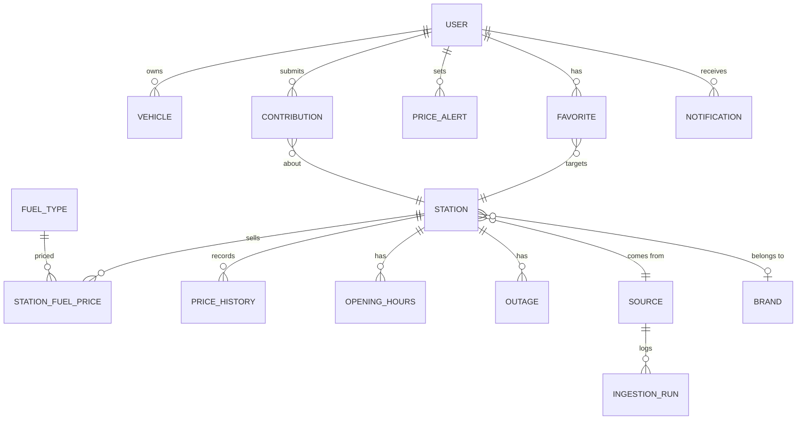

eet# Jauge — Spécification fonctionnelle pour Claude Code

## 0. Instructions pour Claude Code
- Lis ce document en entier avant d'écrire la moindre ligne de code.
- Commence par proposer un plan d'implémentation par phases (MVP → V1 → V2) avec la stack de la section 13, puis attends sa validation.
- Construis d'abord le MVP, de bout en bout, avec des tests qui couvrent les critères d'acceptation.
- En cas d'ambiguïté, applique l'hypothèse la plus simple et consigne-la dans un fichier `DECISIONS.md`.
- Les étiquettes d'origine sont `[Official]` (fonction documentée de l'application de référence), `[Inferred]` (déduite, à confirmer), `[Requested]` (demandée par des utilisateurs ou présente chez des concurrents) et `[Fix]` (comportement corrigé par rapport à un défaut connu).

## 1. Contexte et objectif
- **Application de référence** : *Essence / Gasoil Now* (SAS 03 JULY), une app mobile grand public qui compare les prix des carburants par station autour de soi. Elle s'appuie sur les données publiques de FR, ES, IT et PT, et sur les saisies des utilisateurs en BE, LU, AD et MC.
- **Objectif** : construire une application originale qui offre ces fonctionnalités, en corrige les défauts connus et s'étend à l'**échelle européenne** en **plusieurs langues**.
- **Usage** : **interne**. C'est un outil réservé à une organisation : pas de publicité, pas d'achats intégrés, pas de pages marketing ni d'onboarding commercial. Exception voulue par le commanditaire : l'**inscription autonome** est possible (email + mot de passe, ou Google), mais toujours protégée par une **vérification de l'adresse email** contre les inscriptions frauduleuses.
- **Nom de code** : **Jauge**. L'application ne reprend ni la marque, ni le logo, ni les textes, ni l'identité visuelle de l'original.
- **Proposition de valeur différenciante** :
  - **Zéro publicité, zéro friction.** Les avis récents sur l'original (2026) sont dominés par des pubs plein écran impossibles à fermer, des redirections vers des annonceurs et des crashs après une pub. Ici, l'information doit s'afficher en moins de 3 secondes.
  - **Le vrai coût du plein.** Le classement intègre le coût du détour, le prix au plein selon le véhicule et la fraîcheur du prix. Le plan carburant d'itinéraire, lui, indique où s'arrêter et combien de litres prendre.
  - **Une Europe de sources officielles.** Un connecteur par pays, une nomenclature européenne harmonisée des carburants (E5, E10, B7…), plusieurs devises et une interface multilingue.

## 2. Utilisateurs, rôles et permissions

| Rôle | Description | Peut | Ne peut pas |
|---|---|---|---|
| Visiteur | Personne non connectée | Voir l'écran de connexion et d'inscription, et changer la langue | Consulter les stations (toute l'app est derrière l'authentification) |
| Utilisateur | Compte vérifié et actif | Rechercher, consulter, gérer ses véhicules, favoris, alertes et préférences ; signaler un prix, une rupture, une correction ou une station manquante | Modérer, administrer, voir les données des autres |
| Modérateur | Utilisateur de confiance | Tout ce que fait l'Utilisateur, plus valider ou rejeter les contributions et masquer un prix aberrant | Gérer les comptes et les sources |
| Administrateur | Responsable de l'instance | Tout ce que fait le Modérateur, plus gérer les comptes (activer, désactiver, changer le rôle, réinitialiser le mot de passe), les domaines email autorisés, les connecteurs pays, le référentiel des carburants et les paramètres | — |

Le premier administrateur est créé au premier lancement à partir des variables d'environnement `ADMIN_EMAIL` et `ADMIN_PASSWORD`.

## 3. Périmètre et priorisation

| Module | Fonctionnalité | Priorité | Origine |
|---|---|---|---|
| Comptes | Inscription email + mot de passe avec vérification email (Brevo) | MVP | [Requested] |
| Comptes | Connexion Google (OAuth) | MVP | [Requested] |
| Comptes | Liste de domaines email autorisés (optionnelle) et validation manuelle par un admin (optionnelle) | MVP | [Requested] |
| Comptes | Réinitialisation du mot de passe par email | MVP | [Requested] |
| Données | Connecteurs FR, ES, IT | MVP | [Official] |
| Données | Connecteurs PT, AD, DE, UK, AT | V1 | [Official] PT · [Requested] autres |
| Données | Connecteurs HR, SI, DK, RO (à valider) | V2 | [Inferred] |
| Données | Pays sans open data (BE, LU, MC…) alimentés par les contributions | V1 | [Official] |
| Données | Enrichissement des enseignes via OpenStreetMap (données FR sans enseigne) | MVP | [Inferred] |
| Recherche | Carte avec code couleur selon le prix, et liste synchronisée | MVP | [Official] |
| Recherche | Recherche autour de moi ou d'une adresse (sans géolocalisation obligatoire) | MVP | [Official] + [Fix] |
| Recherche | Tri par prix au litre, prix au plein, distance, « meilleur choix » | MVP | [Official] + [Requested] |
| Recherche | Filtres : carburant, rayon, enseignes (inclusion et exclusion), services, paiement, ouvert maintenant, 24/24, masquer les ruptures | MVP | [Official] + [Fix] |
| Recherche | Bouton « recentrer sur ma position » | MVP | [Requested] |
| Station | Fiche : prix et date de chaque carburant, source, horaires, services, ruptures, itinéraire GPS | MVP | [Official] |
| Coûts | Coût du plein selon le véhicule, économie par rapport à la moyenne de la zone | MVP | [Official] |
| Coûts | Coût du détour (aller-retour) intégré au « meilleur choix » | MVP | [Requested] |
| Véhicules | Plusieurs véhicules (carburant, réservoir, consommation) | MVP | [Official] |
| Favoris | Stations favorites avec leurs prix du jour, suppression évidente | MVP | [Official] + [Fix] |
| Itinéraire | Stations le long d'un trajet | V1 | [Official] |
| Itinéraire | Plan carburant : arrêts, litres par arrêt, coût total ; options éviter péages et autoroutes | V1 | [Requested] |
| Alertes | Alerte de prix sous un seuil (station, favoris ou zone) | V1 | [Official]/[Requested] |
| Historique | Courbe des prix par station et tendance de la zone | V1 | [Requested] |
| Contributions | Signaler une rupture | MVP | [Official] |
| Contributions | Saisir ou corriger un prix (pays sans open data, ou écart constaté) | V1 | [Official] |
| Contributions | Signaler une station manquante, fermée, ou un changement d'enseigne | V1 | [Requested] |
| Contributions | File de modération | V1 | [Inferred] |
| i18n | Interface FR + EN | MVP | [Requested] |
| i18n | ES, IT, PT, DE, NL | V1 | [Official] (5 langues dans l'original) + [Requested] |
| i18n | Plusieurs devises : affichage local, conversion BCE optionnelle | V1 | [Requested] |
| Admin | Gestion des comptes, monitoring des connecteurs, référentiel des carburants | MVP | [Inferred] |
| PWA | Installable, consultation hors ligne de la dernière zone chargée | V1 | [Requested] |
| Partage | Lien partageable vers une vue (carte, filtres, itinéraire) | V1 | [Requested] |
| Journal | Journal de pleins par véhicule (litres, montant, km) et consommation réelle | V2 | [Inferred] |
| Prévision | Indication « attendre ou faire le plein maintenant » à partir de l'historique | V2 | [Requested] |

## 4. Modules fonctionnels

### 4.1 Comptes et authentification
- **But** : réserver l'accès à l'organisation tout en permettant l'inscription autonome, sans comptes frauduleux.
- **User stories**
  - En tant que nouvel arrivant, je veux créer mon compte avec mon email ou Google, pour ne pas dépendre d'un admin.
  - En tant qu'admin, je veux limiter les inscriptions à certains domaines email et pouvoir valider les comptes à la main, pour éviter les intrus.
- **Règles métier**
  - Inscription : email, mot de passe (12 caractères minimum, comparé à une liste de mots de passe compromis courants), nom d'affichage et langue préférée.
  - À l'inscription, le compte est créé au statut `pending_verification`. Un email de vérification est envoyé via **Brevo** (API transactionnelle). Le lien est à usage unique et expire après 24 h. Tant que l'email n'est pas vérifié, aucune connexion n'est possible.
  - On peut redemander un lien au plus 3 fois par heure et par email. L'inscription est limitée à 5 tentatives par heure et par IP.
  - Domaines autorisés : si la liste `allowed_email_domains` n'est pas vide, une inscription hors liste est refusée avec un message neutre. Le même contrôle s'applique à Google.
  - Validation manuelle (paramètre `require_admin_approval`) : une fois l'email vérifié, le compte passe en `pending_approval` jusqu'à l'action d'un admin, qui est notifié dans l'app.
  - Google OAuth : on accepte l'email fourni par Google s'il est marqué vérifié (`email_verified=true`). Il est rattaché au compte existant de même email seulement si ce compte est déjà vérifié.
  - Mot de passe oublié : un lien envoyé via Brevo, valable 1 h et à usage unique. La réponse est identique, que l'email existe ou non.
  - Sessions sécurisées (cookie httpOnly, Secure, SameSite=Lax), déconnexion de toutes les sessions, verrouillage temporaire après 10 échecs.
  - Un admin peut désactiver un compte : ses sessions sont invalidées et ses contributions conservées, anonymisées sur demande. Il n'y a pas de suppression en libre-service.
  - Les emails sont envoyés dans la langue préférée de l'utilisateur. L'expéditeur est configurable (`BREVO_API_KEY`, `MAIL_FROM`, compte Brevo « librehub »).
- **Critères d'acceptation**
  - Un compte non vérifié ne peut pas se connecter, même avec un mot de passe correct.
  - Un lien de vérification réutilisé ou expiré affiche une erreur et propose de renvoyer un lien.
  - Avec `allowed_email_domains=["acme.eu"]`, une inscription `x@gmail.com` est refusée, par email comme par Google.
  - Si l'envoi Brevo échoue, l'erreur est journalisée, l'utilisateur voit « réessayer plus tard » et le compte n'est pas activé.
  - L'admin initial est créé une seule fois au premier démarrage. Les relances suivantes sont idempotentes.

### 4.2 Ingestion des données (connecteurs pays)
- **But** : agréger des prix officiels hétérogènes dans un modèle unique.
- **Règles métier**
  - Il y a un connecteur par source. Chacun déclare son pays, sa fréquence, sa licence, sa mention d'attribution et sa correspondance vers le référentiel des carburants.

    | Pays | Source | Fréquence cible | Particularités |
    |---|---|---|---|
    | FR | Flux `instantane_ruptures` (XML zippé, Licence Ouverte 2.0) | 10 min | Coordonnées ÷ 100 000 ; horaires, automate 24/24, services, ruptures, fermetures ; **ni nom ni enseigne** → enrichissement OSM |
    | ES | API REST MITECO `EstacionesTerrestres` (JSON) | 30 min | Enseigne incluse ; refus fréquents des IP cloud → réessais avec backoff, en-têtes de navigateur |
    | IT | CSV MIMIT `anagrafica_impianti_attivi` + `prezzo_alle_8` | Quotidien | Jointure sur `idimpianto` ; séparateur `|` depuis le 10/02/2026 ; licence IODL 2.0 |
    | PT | Portail DGEG | Quotidien | Continent uniquement, pas d'E10 ni d'horaires ; pas d'API documentée [Inferred] |
    | AD | Flux du gouvernement d'Andorre | Quotidien | Pas d'adresse ni d'horaires [Inferred] |
    | DE | MTS-K via l'API Tankerkönig (clé gratuite, CC BY 4.0) | ≥ 5 min | Diesel, Super E5 et E10 uniquement |
    | UK | Fuel Finder (OAuth2 client credentials, OGL v3) | 30 min | Prix en GBP ; horaires et services inclus |
    | AT | E-Control Spritpreisrechner | 1 h | Seules les stations les moins chères par district sont publiées [Inferred] |
    | HR, SI, DK, RO | Sources nationales à identifier | — | V2, à valider |
    | BE, LU, MC… | Aucune → contributions | — | Afficher le prix maximum légal du jour (BE, LU) comme repère, s'il est disponible |

  - Chaque prix stocke son **horodatage source** (date de mise à jour à la pompe), sa date d'ingestion, sa devise, son unité (L ou kg) et sa provenance (`official` ou `community`).
  - Idempotence : réingérer le même fichier ne crée ni doublon ni faux point d'historique. Un point d'historique est créé seulement si le prix change.
  - Un prix aberrant (hors de [0,3 × ; 3 ×] la médiane du pays pour ce carburant) est mis en quarantaine, exclu des classements et signalé aux modérateurs.
  - Une station absente de sa source pendant 30 jours passe au statut `inactive` et n'est pas supprimée.
  - Chaque exécution est journalisée : début, fin, nombre de stations et de prix créés ou mis à jour, erreurs. Après 3 échecs consécutifs, une alerte apparaît dans l'admin.
  - L'attribution de chaque source est affichée dans « À propos » et sur la fiche station.
- **Critères d'acceptation**
  - Un fichier FR d'exemple (fixture) produit des stations aux bonnes coordonnées WGS84 et des prix horodatés.
  - Deux ingestions successives du même fichier donnent un nombre de points d'historique inchangé.
  - Une source indisponible n'empêche pas l'affichage des autres pays. Les prix restent servis avec leur date réelle.

### 4.3 Recherche, carte et liste
- **But** : trouver en quelques secondes la station la plus pertinente.
- **User stories**
  - En tant qu'utilisateur, je veux voir les stations autour de moi, colorées selon le prix du carburant de mon véhicule, pour repérer d'un coup d'œil les bonnes affaires.
  - En tant qu'utilisateur qui refuse la géolocalisation, je veux chercher une ville ou une adresse et obtenir les mêmes résultats.
- **Règles métier**
  - Le carburant actif vient par défaut du véhicule sélectionné, sinon de la préférence de l'utilisateur.
  - Les zones de recherche sont : position (avec un rayon de 1 à 50 km, 10 km par défaut), adresse géocodée, ou zone visible de la carte (« rechercher dans cette zone »).
  - Code couleur en 3 classes (tiers bas, moyen, haut) calculées sur les stations visibles qui ont un prix frais pour le carburant actif. Le gris signale un prix absent ou périmé.
  - Tris :
    - prix au litre ;
    - prix au plein (prix × litres à ajouter) ;
    - distance ;
    - **meilleur choix**, c'est-à-dire coût du plein + coût du détour aller-retour : distance de route × 2 × consommation × prix local (cf. 4.5).
  - **Fraîcheur** : la date du prix est toujours affichée en relatif (« il y a 2 h »). Un prix de plus de 48 h porte la mention « ancien ». Un prix de plus de 7 jours est exclu par défaut des tris par prix (option pour l'inclure).
  - Filtres :
    - carburant ;
    - enseignes (inclusion ou exclusion) ;
    - services (gonflage, lavage, boutique, toilettes, borne électrique, AdBlue en vrac, GPL…) ;
    - moyens de paiement (carte, espèces, automate 24/24) ;
    - « ouvert maintenant » ;
    - masquer les stations en rupture du carburant actif ;
    - n'afficher que les stations qui vendent le carburant actif (activé par défaut).
  - Bornes de recharge électriques : affichage optionnel, désactivé par défaut pour un véhicule thermique.
  - La carte et la liste restent synchronisées : survoler ou toucher un élément le met en évidence dans l'autre vue.
  - Un bouton « recentrer sur ma position » est toujours visible.
- **Critères d'acceptation**
  - Géolocalisation refusée : la recherche par adresse fonctionne et aucun écran bloquant n'apparaît.
  - Avec le filtre « vend le carburant actif », une station sans B7 n'apparaît pas pour un véhicule B7.
  - La première liste s'affiche en moins de 2 s (p95) pour 200 stations dans le rayon.

### 4.4 Fiche station
- **Contenu** :
  - nom, enseigne (avec sa provenance OSM le cas échéant), adresse, type (route ou autoroute) ;
  - prix de chaque carburant avec sa date, sa provenance et son unité ;
  - horaires en clair (« ouvert jusqu'à 21 h »), automate 24/24, services ;
  - ruptures en cours (temporaires ou définitives) ;
  - fermeture (temporaire ou définitive) ;
  - historique (V1) ;
  - attribution de la source.
- **Actions** : itinéraire via l'app GPS choisie (Google Maps, Apple Plans, Waze, ou OSM par défaut dans le navigateur), ajout aux favoris, signalement (rupture, prix, correction, fermeture).
- **Critères d'acceptation** : une station fermée définitivement n'apparaît plus dans les recherches mais reste accessible par un lien direct, avec un bandeau « fermée ».

### 4.5 Véhicules et calculs de coût
- **Règles métier**
  - Un véhicule a un nom, un carburant principal (et éventuellement un secondaire, pour les bicarburants GPL ou GNV), une capacité de réservoir (L ou kg) et une consommation moyenne (L/100 km ou kg/100 km).
  - Un véhicule est marqué par défaut.
  - Litres à ajouter = capacité × (1 − niveau actuel). Le niveau se règle par un curseur (25 % par défaut) et se mémorise par session.
  - Économie affichée = (prix médian de la zone − prix de la station) × litres − coût du détour.
  - Coût du détour = distance routière aller-retour depuis la position ou depuis l'itinéraire × consommation × prix de la station. Il se calcule avec un service de routage. À défaut, on prend la distance à vol d'oiseau × 1,3, avec la mention « estimée ».
- **Critères d'acceptation** :
  - Une station moins chère de 0,02 €/L mais à 15 km ne bat pas une station à 1 km pour un plein de 30 L : le test calcule les deux et vérifie l'ordre.
  - Les calculs respectent l'unité du carburant (CNG et H2 sont en kg).

### 4.6 Favoris
- Une liste de favoris (de tous pays) affiche le prix du jour du carburant actif, sa date, et l'écart avec la veille.
- Le retrait se fait par une icône explicite (cœur plein ou vide) sur la fiche et dans la liste, avec la possibilité d'annuler pendant 5 s. Cela corrige un défaut de l'original : on ne savait pas comment supprimer un favori. `[Fix]`
- Les favoris servent de tri et de filtre (« favoris d'abord »).

### 4.7 Itinéraire et plan carburant (V1)
- **User stories** : en tant que conducteur, je veux saisir un départ et une arrivée pour savoir où m'arrêter et combien de litres prendre à chaque arrêt, au meilleur coût total.
- **Règles métier**
  - On saisit un départ, une arrivée, jusqu'à 3 étapes, le véhicule, le niveau de départ, la réserve de sécurité minimale (15 % par défaut) et les options « éviter péages » et « éviter autoroutes ».
  - Corridor de recherche : 5 km autour du tracé (réglable de 1 à 20 km).
  - Trois stratégies :
    1. **Moins d'arrêts** : faire le plein complet le plus tard possible.
    2. **Coût minimal** : remplir juste ce qu'il faut pour atteindre la station suivante moins chère, en traversant les frontières si c'est rentable.
    3. **Équilibré** : au plus 2 arrêts, coût minimal sous cette contrainte.
  - Résultat : la liste des arrêts (station, litres, prix, coût, détour), le coût total du carburant et l'économie par rapport à un plein au départ.
  - L'itinéraire est partageable par lien, et l'export vers l'app GPS se fait arrêt par arrêt.
- **Critères d'acceptation** : sur un trajet FR → ES fictif (fixtures), la stratégie « coût minimal » place l'arrêt côté ES si le prix y est plus bas et que le détour ne l'annule pas.

### 4.8 Alertes de prix (V1)
- Une alerte porte sur une station, sur l'ensemble des favoris ou sur une zone (centre + rayon), avec un carburant, un seuil (prix au litre) et un état actif ou inactif.
- Elle se déclenche quand un prix ingéré passe sous le seuil, au plus une fois par alerte et par 24 h, et se réarme quand le prix repasse au-dessus.
- Canaux : notification dans l'app (toujours), notification push Web Push si autorisée, et email Brevo si l'utilisateur l'a activé.
- Critères d'acceptation : une ingestion qui fait passer le prix de 1,80 à 1,69 avec un seuil de 1,70 déclenche une seule notification, même si 3 ingestions suivent à 1,69.

### 4.9 Historique et tendances (V1)
- Courbe du prix par station et par carburant (7 jours, 30 jours, 1 an). Courbe de la médiane de la zone ou du pays.
- Indicateur de tendance (hausse, stable, baisse) sur 7 jours. La V2 ajoutera l'indication « attendre ou faire le plein » à partir des cycles hebdomadaires observés.
- Import initial des historiques disponibles : archives annuelles FR depuis 2007, archives trimestrielles IT, historique ES par jour. Fenêtre configurable, 1 an par défaut.

### 4.10 Contributions communautaires et modération
- **Types** :
  - rupture d'un carburant (MVP) ;
  - prix constaté (V1, obligatoire pour les pays sans open data) ;
  - station fermée ;
  - changement d'enseigne ;
  - station manquante, avec position sur la carte ;
  - correction d'horaires ou de services.
- **Règles métier**
  - Une rupture signalée par un utilisateur est affichée tout de suite avec la mention « signalée par la communauté, il y a X min ». Elle expire au bout de 12 h sans confirmation, ou dès que la source officielle publie un prix plus récent pour ce carburant.
  - Un prix communautaire n'écrase jamais un prix officiel plus récent. Il ne s'affiche que si aucun prix officiel n'a moins de 24 h, et toujours avec la mention « communauté ».
  - Un écart de plus de 15 % par rapport à la médiane locale déclenche une mise en modération avant publication.
  - Réputation simple : chaque contribution validée donne +1, chaque rejet −3. En dessous de −5, les contributions passent systématiquement en modération.
  - Les modérateurs voient la file, la carte, l'historique de la station et l'auteur, et peuvent valider ou rejeter avec un motif.
- **Critères d'acceptation** : un prix communautaire saisi à 1,20 €/L, alors que la médiane locale est de 1,75, n'est pas visible avant validation.

### 4.11 Administration
- Comptes : liste avec recherche, filtres par statut et par rôle, actions (activer, désactiver, changer le rôle, renvoyer la vérification, réinitialiser le mot de passe).
- Paramètres : domaines autorisés, validation manuelle, langues actives, pays actifs, seuils de fraîcheur et d'aberration.
- Connecteurs : état, dernière exécution, durée, volumes, erreurs, bouton « exécuter maintenant », activation par pays.
- Référentiel des carburants : codes harmonisés UE (norme EN 16942 : E5, E10, E85, B7, B10, XTL, LPG, CNG, LNG, H2) plus AdBlue, avec libellés traduits et correspondance par source. Cela corrige les libellés obscurs de l'original et la confusion entre gazole standard et premium. `[Fix]`
- Journal d'audit des actions admin et modérateur.

### 4.12 Internationalisation et préférences
- Langue de l'interface et des emails par utilisateur, détectée au départ depuis le navigateur.
- Formats de nombres, dates et monnaies localisés (Intl). Les prix s'affichent avec 3 décimales, dans la devise d'origine. Le paramètre (V1) « convertir en » utilise les taux du jour publiés par la BCE, avec la mention « converti ».
- Préférences : unité de distance (km ou miles, miles par défaut pour le compte UK), carburant par défaut, rayon par défaut, app GPS préférée, thème clair, sombre ou système.

### 4.13 Journal de pleins (V2)
- Saisie d'un plein : véhicule, station, litres, montant, kilométrage. Calcul de la consommation réelle, qui peut mettre à jour la consommation moyenne du véhicule. Export CSV.

## 5. Parcours utilisateurs clés

**Premier lancement (instance)**
1. Démarrage avec `ADMIN_EMAIL` et `ADMIN_PASSWORD` : création de l'admin, des pays par défaut (FR, ES, IT) et du référentiel des carburants.
2. L'admin se connecte, configure les domaines autorisés et Brevo, puis lance la première ingestion.
3. L'écran des connecteurs passe au vert pour chaque pays actif.

**Inscription**
1. Écran « Créer un compte » : email + mot de passe, ou « Continuer avec Google ».
2. Email de vérification (Brevo) → clic → compte actif, ou en attente de validation si l'option est active.
3. Première connexion : un seul écran facultatif, « Ajouter mon véhicule » (carburant, réservoir, consommation), qu'on peut passer.

**Trouver une station (flux principal)**
1. Ouverture → carte centrée sur la position, ou sur la dernière zone si la géolocalisation est refusée. Les prix du carburant du véhicule par défaut s'affichent.
2. Tri par « meilleur choix » → la première station affiche son prix, son coût au plein, son détour et l'économie réalisée.
3. Toucher la station → fiche → « Y aller » ouvre l'app GPS.
4. Sur place : signaler une rupture ou un écart de prix en 2 gestes.

**Préparer un long trajet (V1)**
1. Onglet Itinéraire → départ, arrivée, véhicule, niveau actuel.
2. Choix de la stratégie → liste des arrêts → partage du lien ou ouverture dans l'app GPS.

**Surveiller les prix (V1)**
1. Sur une fiche ou sur les favoris → « Créer une alerte » → seuil.
2. Notification → ouverture directe de la fiche station.

## 6. Modèle de données

| Entité | Champs principaux |
|---|---|
| User | id, email (unique), email_verified_at, password_hash (nullable si Google uniquement), google_sub (nullable), display_name, role (`user`/`moderator`/`admin`), status (`pending_verification`/`pending_approval`/`active`/`disabled`), locale, preferences (json : distance_unit, default_fuel, radius_km, nav_app, theme, display_currency, email_alerts), reputation (int), created_at |
| VerificationToken | id, user_id, type (`email_verify`/`password_reset`), token_hash, expires_at, used_at |
| Vehicle | id, user_id, name, fuel_code, secondary_fuel_code (nullable), tank_capacity, consumption_per_100km, is_default |
| Source | id, country (ISO 3166-1), name, kind (`official`/`community`), license, attribution, schedule (cron), enabled, last_success_at |
| IngestionRun | id, source_id, started_at, finished_at, status, stations_upserted, prices_changed, error |
| Brand | id, name, osm_brand_wikidata (nullable) |
| Station | id, source_id, external_id (unique par source), country, name (nullable), brand_id (nullable), brand_origin (`source`/`osm`/`community`), address, postal_code, city, location (geography Point), road_type (`road`/`motorway`/`unknown`), is_24h_automat, services (text[]), payment_methods (text[]), status (`active`/`closed_temp`/`closed`/`inactive`), last_seen_at |
| OpeningHours | station_id, weekday (0-6), opens, closes, is_closed |
| FuelType | code (`E5`/`E10`/`E85`/`B7`/`B10`/`XTL`/`LPG`/`CNG`/`LNG`/`H2`/`ADBLUE`/`B7_PREMIUM`/`E5_98`), unit (`L`/`kg`), labels (json par langue), eu_symbol |
| StationFuelPrice | station_id, fuel_code, price, currency (ISO 4217), source_updated_at, ingested_at, origin (`official`/`community`), quarantined (bool) |
| PriceHistory | station_id, fuel_code, price, currency, valid_from (index (station, fuel, valid_from)) |
| Outage | id, station_id, fuel_code, kind (`temporary`/`permanent`), started_at, ended_at, origin, reported_by (nullable) |
| Favorite | user_id, station_id, created_at (unique (user, station)) |
| PriceAlert | id, user_id, scope (`station`/`favorites`/`area`), station_id (nullable), center (Point nullable), radius_km, fuel_code, threshold, active, last_triggered_at, armed |
| Contribution | id, user_id, station_id (nullable si station manquante), type (`outage`/`price`/`closed`/`brand_change`/`missing_station`/`hours`), payload (json), status (`pending`/`published`/`rejected`/`expired`), moderator_id, reason, created_at |
| Notification | id, user_id, type, payload, read_at, created_at |
| AuditLog | id, actor_id, action, target_type, target_id, data, created_at |
| Setting | key, value (json) |

## 7. Offres, quotas et limites
Sans objet (usage interne).

### Questions ouvertes

| Point | Source A | Source B | Décision prise |
|---|---|---|---|
| Modèle d'accès | Mode interne standard : comptes créés par l'admin, pas d'inscription | Demande explicite : inscription email + Google avec vérification email | Inscription autonome vérifiée, plus domaines autorisés et validation admin en option |
| Fonction premium de l'original | 2016 : itinéraire et rayon réservés aux payants (iphonesoft) | 2026 : achat « option annuelle 0,99 € » sans détail (App Store) | Tout inclus, sans distinction |
| Alerte de prix dans l'original | Demandée en 2023 (avis App Store) | Citée comme existante en janvier 2026 (avis App Store) | Considérée comme existante ; mise en V1 |
| Source PT | L'original cite precoscombustiveis.dgeg.gov.pt | Aucune API publique documentée trouvée | Connecteur V1 sous réserve d'un accès stable ; sinon mode communautaire |
| Source AT | Spritpreisrechner E-Control | Seules les stations les moins chères seraient publiées (site tiers) | Afficher un avertissement « couverture partielle » pour l'Autriche |
| HR, SI, DK, RO | Un agrégateur affirme publier des prix par station | Sources officielles non identifiées | V2, à valider avant de développer |
| Contexte d'usage interne | Consultation pour une équipe | Gestion de flotte (plafonds, cartes carburant) | Consultation ; le journal de pleins est en V2, la gestion de flotte hors périmètre |

## 8. Intégrations, import/export, API
- **Brevo** : API transactionnelle pour la vérification email, la réinitialisation du mot de passe et les alertes par email. Gabarits par langue, versionnés dans le dépôt.
- **Google OAuth 2.0 / OpenID Connect** : connexion.
- **Sources de prix** : voir 4.2.
- **OpenStreetMap** : fonds de carte (tuiles vectorielles, par exemple OpenFreeMap ou un serveur auto-hébergé), enseignes des stations (`amenity=fuel`, rapprochement à moins de 50 m), géocodage (Nominatim ou Photon auto-hébergé, en respectant la politique d'usage).
- **Routage** : OSRM ou Valhalla (auto-hébergeable) pour les distances de détour et les itinéraires, avec les options péages et autoroutes.
- **Taux de change** : flux quotidien de la BCE.
- **Deep links de navigation** : Google Maps, Apple Plans, Waze, geo: URI.
- **Export** : CSV des favoris, de l'historique d'une station et du journal de pleins (V2).
- **API interne** : routes JSON authentifiées utilisées par le front. Pas d'API publique ni de webhooks (hors périmètre).

## 9. Notifications

| Événement | In-app | Push (Web Push) | Email (Brevo) |
|---|---|---|---|
| Vérification email, réinitialisation du mot de passe | — | — | Toujours |
| Alerte de prix déclenchée | Oui | Si autorisée | Si activé |
| Contribution validée ou rejetée | Oui | Non | Non |
| Compte en attente de validation (pour les admins) | Oui | Si autorisée | Option |
| Échecs répétés d'un connecteur (pour les admins) | Oui | Non | Option |

Les préférences se règlent par type d'événement et par canal. Pas de notification marketing.

## 10. Exigences non fonctionnelles
- **Performance** : liste et carte en moins de 2 s (p95) pour un rayon de 10 km. Requêtes géographiques indexées (GiST). Écran utile en moins de 3 s sur une connexion 4G moyenne. Aucun écran interstitiel. `[Fix]`
- **Montée en charge** : les données servies viennent de la base locale, jamais d'appels synchrones aux sources. L'app reste disponible si une source tombe, ce qui corrige les indisponibilités de l'original pendant la pénurie de 2022. `[Fix]`
- **Sécurité** : mots de passe hachés (argon2id), CSRF, limitation de débit sur l'authentification et les contributions, en-têtes de sécurité (CSP), secrets en variables d'environnement, journal d'audit.
- **RGPD et vie privée** :
  - aucun traceur publicitaire ni SDK tiers d'analytics ;
  - la position n'est **jamais stockée côté serveur**, seulement utilisée pour la requête ;
  - géolocalisation facultative (corrige « forcer la géolocalisation » de l'original) `[Fix]` ;
  - export des données personnelles sur demande, anonymisation par l'admin.
- **Accessibilité** : WCAG 2.1 AA. Le code couleur des prix est doublé d'une valeur textuelle et d'un motif ou libellé (bas, moyen, haut). La liste est utilisable sans la carte, au clavier et avec un lecteur d'écran.
- **i18n** : toutes les chaînes externalisées, y compris les emails et les libellés de carburants. Pluralisation et formats localisés. Ajouter une langue ne demande aucun changement de code.
- **Responsive et mobile** : PWA installable, mobile d'abord (carte plein écran + panneau coulissant) et panneaux latéraux sur grand écran. Compatible avec les navigateurs des Android ou iOS vieux de 5 ans, ce qui évite le « téléphone plus compatible » de l'original. `[Fix]`
- **Hors ligne (V1)** : la dernière zone et les favoris restent consultables, avec un bandeau « hors ligne, données du JJ/MM HH:MM ».
- **Batterie** : pas de suivi de position en arrière-plan. La géolocalisation n'est demandée qu'à la recherche. `[Fix]`
- **Sauvegardes** : dump PostgreSQL quotidien, rétention de 14 jours, procédure de restauration documentée.
- **Observabilité** : logs structurés, endpoint de santé, métriques des connecteurs.
- **Attributions et licences** : mentions de chaque source dans « À propos » (Licence Ouverte, IODL, CC BY, OGL, ODbL pour OSM).

## 11. Défauts de l'original à éviter

| Défaut constaté | Comportement attendu dans Jauge |
|---|---|
| Publicités plein écran impossibles à fermer, redirections vers des annonceurs, crash après une pub (majorité des avis 2026) | Aucune publicité. Résultats affichés directement à l'ouverture |
| Option payante expirée sans prévenir ; pseudo modifié tout seul | Pas de paiement. Le profil n'est jamais modifié sans action de l'utilisateur ou de l'admin, et toute modification admin est tracée |
| Géolocalisation imposée | Recherche complète par adresse. Géolocalisation facultative |
| Prix pas à jour ou faux, sans que l'utilisateur le sache | Date et provenance de chaque prix affichées, prix anciens signalés et exclus des tris, priorité aux sources officielles, modération des saisies aberrantes |
| Diesel premium non distingué : trajet inutile | Carburants premium distincts, filtre « vend ce carburant » activé par défaut |
| Stations sans le carburant voulu affichées ; bornes électriques qui encombrent la carte | Filtrage strict par carburant ; bornes masquées par défaut pour les véhicules thermiques |
| Station fermée à l'arrivée | Horaires en clair, filtre « ouvert maintenant », fermetures de la source, signalement de fermeture |
| Classement au seul prix au litre | « Meilleur choix » qui intègre le coût du détour aller-retour et le plein réel |
| Ne sait pas si le trajet proposé est le plus économique ou le plus rapide | Détour affiché en km, en minutes et en coût ; plan d'itinéraire avec stratégies explicites |
| Suppression d'un favori introuvable | Bouton explicite et annulation possible |
| Libellés de carburants obscurs | Codes harmonisés UE + libellé traduit + infobulle |
| Pas de bouton « revenir à ma position » | Bouton de recentrage permanent |
| Stations manquantes (certaines enseignes, DOM) | Signalement de station manquante. DOM inclus dans le flux FR quand ils y figurent |
| Écran blanc au démarrage, incompatibilité après mise à jour | PWA tolérante (dernière zone en cache), test e2e de démarrage, support large des navigateurs |
| Indisponibilité en période de forte demande (pénurie 2022) | Données servies depuis la base locale, cache HTTP, dégradation gracieuse |
| Application non installable dans certains pays (restriction de store) | PWA, sans dépendance aux stores |
| Consommation de batterie en arrière-plan | Aucune activité en arrière-plan hors notifications push |

## 12. Hors périmètre
- **Usage interne** : publicité, achats intégrés, abonnements, offres et quotas, pages marketing, essai gratuit, visite guidée et données de démonstration, suppression de compte en libre-service (remplacée par la désactivation ou l'anonymisation par l'admin).
- **Usage interne, décision du commanditaire** : 2FA (non demandée ; à envisager plus tard), connexion par d'autres fournisseurs que Google.
- **Applications natives et CarPlay / Android Auto** : demande réelle des utilisateurs de l'original, mais incompatible avec le choix d'une PWA. À réévaluer si une app native est envisagée.
- **Qualité et composition des carburants** : aucune donnée fiable disponible.
- **Gestion de flotte complète** (plafonds de dépense, rapprochement avec les cartes carburant, télématique) : hors besoin exprimé. Seul le journal de pleins est prévu, en V2.
- **API publique et webhooks.**
- **Prix des bornes de recharge électrique** : affichage de leur présence seulement.

## 13. Stack technique
Stack **choisie par l'utilisateur** parmi les options proposées (option recommandée).

- **Front et back** : Next.js (App Router) + TypeScript strict, en une seule application. Simple à déployer, et les Server Actions et routes API suffisent pour une API interne.
- **UI** : Tailwind CSS + shadcn/ui. Composants accessibles prêts à l'emploi.
- **Carte** : MapLibre GL JS avec des tuiles vectorielles OSM. Gratuit, sans clé, et il tient des milliers de points en clustering.
- **Base de données** : PostgreSQL 16 + PostGIS, via Drizzle ORM. Les requêtes de rayon, de corridor d'itinéraire et de plus proche voisin sont natives et indexées.
- **Auth** : Better Auth, qui couvre email + mot de passe, Google OAuth, vérification email, réinitialisation, rate limiting, et dont la persistance passe par Drizzle.
- **Emails** : API transactionnelle Brevo (SDK officiel ou fetch), avec des gabarits React Email rendus par langue.
- **Jobs planifiés** : pg-boss, une file dans PostgreSQL qui évite d'ajouter Redis, pour les connecteurs, les alertes, l'expiration des ruptures et les taux BCE. Il s'exécute dans un processus worker séparé de la même image.
- **i18n** : next-intl, avec des fichiers de messages par langue (fr, en au MVP).
- **PWA** : manifeste, service worker (Serwist) pour le cache hors ligne et Web Push (VAPID).
- **Routage et géocodage** : OSRM ou Valhalla et Photon ou Nominatim, auto-hébergés ou via des instances publiques en développement, derrière une interface interne pour en changer facilement.
- **Tests** : Vitest (connecteurs sur fixtures, calculs de coût, règles d'alerte et de contribution) et Playwright (inscription + vérification avec Brevo mocké, recherche, fiche, favoris).
- **Déploiement** : Docker Compose (app, worker, postgres/postgis, et optionnellement OSRM). Variables : `DATABASE_URL`, `BETTER_AUTH_SECRET`, `GOOGLE_CLIENT_ID/SECRET`, `BREVO_API_KEY`, `MAIL_FROM`, `ADMIN_EMAIL`, `ADMIN_PASSWORD`, `TANKERKOENIG_API_KEY`, `FUEL_FINDER_CLIENT_ID/SECRET`, `VAPID_*`.

## Annexe — Sources

**Officielles (application de référence)**
- https://play.google.com/store/apps/details?id=com.toj.gasnow&hl=fr
- https://apps.apple.com/fr/app/essence-gasoil-now/id681463839
- https://apps.apple.com/fr/app/essence-gasoil-now/id681463839?see-all=reviews
- https://iphonesoft.fr/2016/02/16/gasoil-now-renforce-modele-payant-in-app
- https://iphonesoft.fr/2019/04/08/gasoil-now-4-0-l-app-trouver-l-essence-bornes-electriques-gonfleurs
- https://iphonesoft.fr/2020/01/19/gasoil-now-liste-prix-carburant-belgique-espagne-italie-portugal
- https://iphonesoft.fr/2022/04/02/profitez-baisse-prix-essence-app-gasoil-now
- https://www.journaldugeek.com/telecharger/loisirs/automobile/gasoil-now.html
- https://lecafedugeek.fr/gasoil-now-connaitre-prix-lessence-autour-soi/

**Sources de données**
- https://www.prix-carburants.gouv.fr/rubrique/opendata/
- https://datos.gob.es/en/catalogo/e05068001-precio-de-carburantes-en-las-gasolineras-espanolas
- https://github.com/carlosveny/fuel-price-api
- https://www.mimit.gov.it/it/open-data/elenco-dataset/carburanti-prezzi-praticati-e-anagrafica-degli-impianti
- https://www.mimit.gov.it/images/stories/documenti/Metadati_prezzi_carburanti_20260128.pdf
- https://precoscombustiveis.dgeg.gov.pt/
- https://www.openhab.org/addons/bindings/tankerkoenig/
- https://community.openstreetmap.org/t/undiskutierter-cng-import/72791?page=2
- https://www.gov.uk/guidance/access-the-latest-fuel-prices-and-forecourt-data-via-api-or-email
- https://euenergyprices.eu/en/fuel/at/stations
- https://apify.com/rainminer/spritpreisrechner-at-scraper/api
- https://www.fuel-prices.eu/live/
- https://www.fuel-prices.eu/ai/catalog.json

**Retours et bugs**
- https://play.google.com/store/apps/details?id=com.toj.gasnow&hl=fr (avis 2024-2026)
- https://apps.apple.com/fr/app/essence-gasoil-now/id681463839?see-all=reviews
- https://worldsapps.com/fr/reviews-gas-now-gas-price-comparator
- https://iphonesoft.fr/2022/10/10/app-gratuite-trouver-essence-penurie

**Avis et comparaisons**
- https://github.com/aslafy-z/plein
- https://www.clubic.com/telecharger-fiche437277-fuel-flash.html
- https://www.appbrain.com/app/petroly-cheap-fuel-finder/tech.pertiller.petroly
- https://www.mietwagen-talk.de/forum/thread/16308-tankstellen-apps-im-vergleich/
- https://www.appgefahren.de/?p=24861
- https://www.samsara.com/fr/products/telematics/fleet-fuel-management-system
- https://www.lafabriquedunet.fr/logiciel/suivideflotte

**Non lues ou sans résultat**
- https://media.roole.fr/quotidien/au-volant/crushtest-gasoil-now-pour-trouver-la-station-service-la-moins-chere : HTTP 429, seul l'extrait du moteur de recherche a été exploité.
- Reddit : 3 recherches (FR, DE, Europe) sans aucun fil pertinent.
- Aucun site officiel, centre d'aide ou tableau de suggestions public pour Gasoil Now.
- Sources officielles HR, SI, DK, RO : non identifiées.
- Écartées : zylalabs.com et oilpriceapi.com (API commerciales de moyennes nationales, hors sujet).
